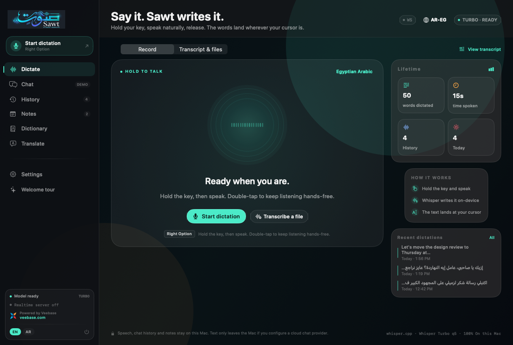
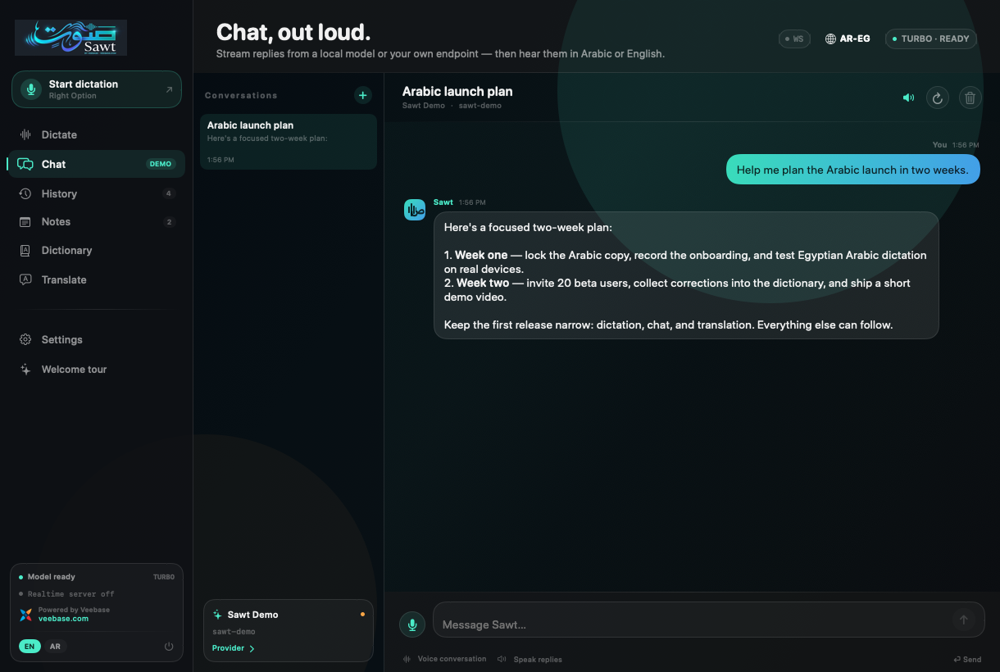
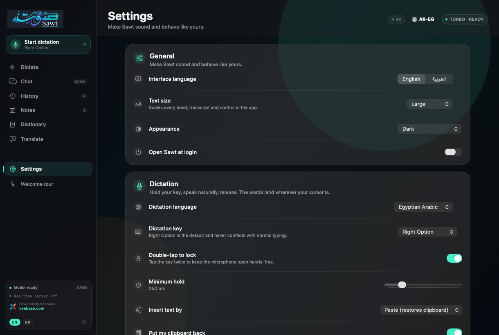
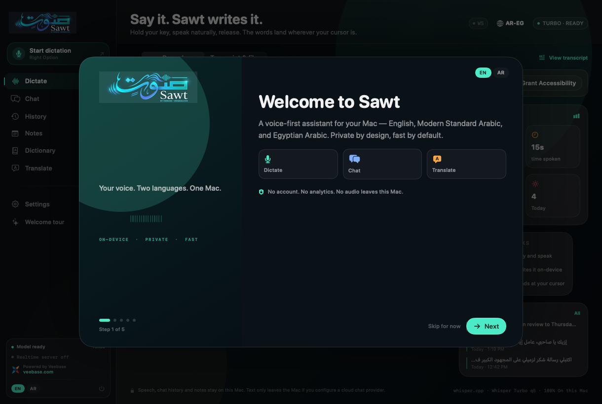

# Sawt · صوت

**A bilingual, voice-first workspace for macOS.**  
Dictate into any app, talk to a model, hear the answer back, take voice notes and edit text with AI — in English, Modern Standard Arabic and Egyptian Arabic.

**Powered by [Veebase](https://veebase.com)**

[**Download Sawt 1.0.2 →**](https://github.com/Hmzeid/Sawt-Updates/releases/tag/v1.0.2) · [Latest release](https://github.com/Hmzeid/Sawt-Updates/releases/latest) · [Business license](https://veebase.com/contact)

---

## What you get

| | |
|---|---|
| **Dictation** | Hold Right Option, speak, release. Sawt transcribes English, Modern Standard Arabic and Egyptian Arabic and types at your cursor. Record and Transcript pages keep the screen uncluttered. |
| **Natural speech** | English uses Pocket TTS. Arabic defaults to the fast 60 MB Kareem voice; MOSS, Azure Egyptian, ElevenLabs, OpenAI and macOS voices are available. |
| **Chat** | Streaming chat with NVIDIA NIM, DeepSeek, Google Gemini, OpenAI, Ollama, LM Studio and Apple Intelligence, with live model dropdowns. |
| **Voice notes** | Record in Notes; Sawt keeps the audio, transcribes it, and lets you play, read, insert or fix the transcript. |
| **AI editing** | Fix mistakes, summarize, extend or add tashkeel. Quran and hadith passages are preserved word-for-word and vocalized carefully. |
| **Translation** | On-device Arabic ↔ English with Apple Translation. |
| **In-app updates** | Sawt checks a signed update feed and installs new versions from inside the app. |

## Screenshots

<table>
<tr>
<td width="50%"></td>
<td width="50%"></td>
</tr>
<tr>
<td></td>
<td></td>
</tr>
</table>

## Requirements

- macOS 14 Sonoma or later (Pocket TTS needs macOS 15; Apple Translation/Apple Intelligence need macOS 26)
- Apple Silicon Mac
- Microphone, Accessibility and Input Monitoring permissions
- ~735 MB installed; Pocket TTS downloads ~145 MB on first use. MOSS is optional and larger.

## Install

1. Download the latest DMG from [Releases](https://github.com/Hmzeid/Sawt-Updates/releases/latest).
2. Open the DMG and drag **Sawt** into **Applications**.
3. Right-click **Sawt → Open** if Gatekeeper blocks the ad-hoc build.
4. On first launch, allow **Microphone**, **Accessibility** and **Input Monitoring** in System Settings. Accessibility is required to type into other apps.
5. Press **Right Option** and speak.

The app is ad-hoc signed, not notarized. macOS may ask you to re-enable Accessibility/Input Monitoring after an update because the signature changes.

## Updates

Sawt checks `updates.json` daily and from **Settings → About → Check for Updates**. The feed is Ed25519-signed and the DMG SHA-256 is verified before installation. You can also download every release manually from this page.

## License

Sawt is **free for personal, non-commercial use**. **Business use requires a paid license** from Veebase LLC. The source code may not be copied, modified, forked, redistributed or reused, and packages may not be mirrored.

See [LICENSE](LICENSE) or contact [Veebase](https://veebase.com/contact).

## Privacy

Speech recognition and local voices run on this Mac. There is no account, analytics or telemetry. Cloud chat/AI and cloud voices are opt-in and use the provider you configure.

---

© 2026 Veebase LLC. Sawt is powered by Veebase.
